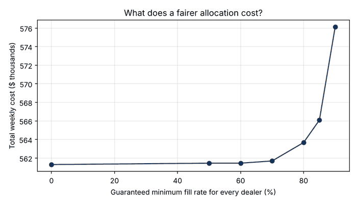
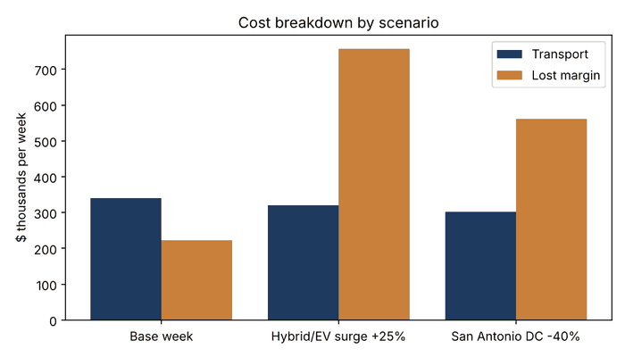

# Vehicle Allocation Optimizer (Gurobi MIP)

A mixed-integer programming model that decides **how many vehicles of each model to ship from each distribution center (DC) to each dealer**, using full car-hauler trucks, so that total cost (transport plus lost gross margin from unfilled demand) is as low as possible.

It also answers a business question: **what does it cost to guarantee every dealer a fair minimum share of supply?**

> All data is synthetic, built to look like a weekly North American allocation: 3 DCs, 6 models (hybrid, gas, truck, EV) and 20 dealers.

## Key results (base week)

| Metric | Value |
|---|---|
| Vehicles shipped | 896 |
| Trucks dispatched | 114 |
| Truck utilization | 98.2% |
| Overall demand filled | 92.6% (supply covers ~92% of demand) |
| Solve time | seconds per scenario (Gurobi, MIP gap ≤ 0.1%) |

**Fairness is cheap, up to a point.** Without a fair-share rule, the cheapest plan leaves one dealer with only 49% of its demand. Guaranteeing every dealer at least **85%** raises total cost by just **0.9%**; pushing to **90%** costs **2.6%**.



**Scenarios** (each with a 70% fair-share floor):

| Scenario | Total cost | Transport | Lost margin | Overall fill |
|---|---|---|---|---|
| Base week | $561.7K | $339.7K | $222.0K | 92.6% |
| Hybrid/EV demand +25% | $1,076.5K | $319.5K | $757.0K | 78.5% |
| San Antonio DC supply −40% | $863.9K | $302.3K | $561.6K | 82.0% |

A hybrid demand surge nearly doubles weekly cost, almost all of it lost margin, which points to supply mix, not logistics, as the lever to pull.



## The model

**Sets:** DCs *d*, models *m*, dealers *j*.

**Decision variables**
- `x[d,m,j]` (integer): vehicles of model *m* shipped from DC *d* to dealer *j*
- `y[d,j]` (integer): trucks dispatched on lane *d → j*
- `s[m,j]` (continuous ≥ 0): unfilled demand (lost sales)

**Objective:** minimize Σ truck_cost[d,j]·y[d,j] + Σ margin[m]·s[m,j]

**Constraints**
1. Supply: Σ_j x[d,m,j] ≤ supply[d,m]
2. Demand balance: Σ_d x[d,m,j] + s[m,j] = demand[j,m]
3. Truck loading: Σ_m x[d,m,j] ≤ 8·y[d,j]
4. Dealer lot capacity: Σ_{d,m} x[d,m,j] ≤ lot_capacity[j]
5. Fair share (optional): Σ_{d,m} x[d,m,j] ≥ floor · min(demand[j], lot_capacity[j])

Truck cost = fixed dispatch cost + cost per mile × road distance (great-circle × 1.2).

## Run it

```bash
pip install -r requirements.txt
python run_scenarios.py
```

`pip install gurobipy` includes a free size-limited license, which is enough for this model (about 540 variables). Results are written to `results/`.

## Files

- `data.py`: synthetic demand, supply, distances and costs
- `model.py`: the Gurobi MIP
- `run_scenarios.py`: scenario analysis, fairness trade-off curve, charts

## Possible extensions

Multi-week horizon with inventory carryover; rail vs. truck mode choice; demand uncertainty via stochastic or robust optimization; an API wrapper for scheduled runs.
